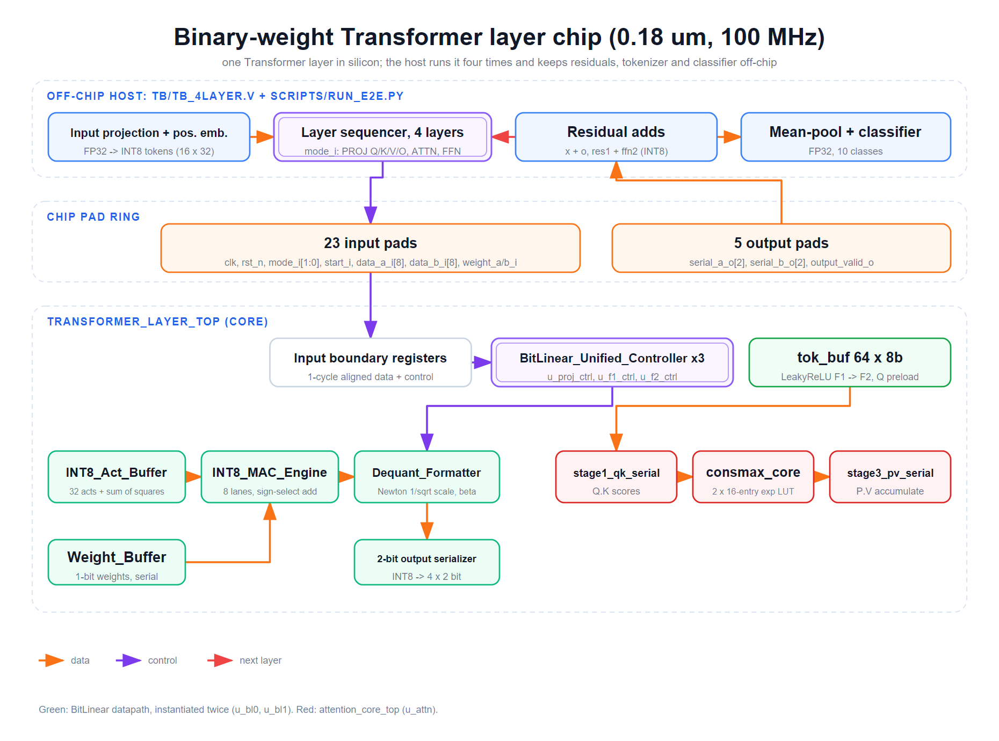

<h1 align="center">Binary-Weight Transformer Accelerator in 0.18 µm CMOS</h1>
<p align="center">A binary-weight, INT8-activation Transformer-layer accelerator taped out in 0.18 µm CMOS, signed off post-layout at 100 MHz and 34.8 mW.</p>
<p align="center"></p>

## Overview

This chip was the final project of the Integrated Circuits Design Laboratory course at National Taiwan University (February to June 2026). Three students built it and submitted it for fabrication in June 2026.
The model is a 4-layer Transformer with binary (+1/-1) weights, INT8 activations, d_model 32, FFN width 32 and 16 tokens. The chip implements the datapath of one layer, with projection, attention and FFN modes sharing 28 time-multiplexed signal pins. The host runs the chip four times and does the input projection, the residual adds and the classifier in FP32.
The linear layers add or subtract INT8 activations according to the weight bit, so the dot products need no multipliers. RMSNorm scaling uses a Newton-Raphson inverse square root, and attention uses ConSmax, which replaces softmax with two 16-entry exponential tables and a learned constant.
The model was trained with the RTL's fixed-point arithmetic inside its forward pass, so the PyTorch model and the RTL produce the same bits. The design decisions are explained in [docs/DESIGN.md](docs/DESIGN.md).

## Results

The chip numbers below are post-layout sign-off figures from the team's tape-out design report. That report and the layout, netlist and timing files behind it are not in this repository. Silicon has not been measured.

| Metric | Value | Source |
| --- | --- | --- |
| Process | 0.18 µm CMOS, 1P6M, cell-based flow | design report |
| Package and pads | 40-pin side-braze package; 36 pads used: 28 signal (23 in, 5 out), 8 power | design report |
| Clock | 100 MHz (10 ns), one clock domain | design report |
| Worst setup / hold slack, post-layout | 0.647 ns / 0.001 ns | design report |
| Total power, post-layout | 34.8 mW (clock network about 64%) | design report |
| Chip area | 2.01 mm2 | design report |
| Physical checks | DRC and LVS clean apart from the foundry's waivable rules | design report |
| Cycles per layer | about 4 x 1,283 (Q/K/V/O) + 8,192 (attention) + 2,743 (FFN), roughly 16,000 | design report |
| Model size | 26,492 parameters | `software/train.log` |
| MNIST test accuracy (10 classes, 16x16 input) | 96.75% (best epoch) | `software/train.log` |
| MIT-BIH ECG accuracy (2 classes) | 96.25% | design report; that model is not in this repository |
| RTL vs. fixed-point model, 4 layers, MNIST test image 67 | 512 of 512 output bytes identical | `tb/pattern_full/rtl_l3_out.hex` vs. `tb/pattern_L3/layer_gold.hex` |

Both accuracy figures belong to the fixed-point model that the RTL reproduces bit for bit. RTL simulation (VCS) ran per mode and as a 4-layer end-to-end test with zero mismatches. The team repeated the end-to-end test on the post-layout netlist with SDF at 100 MHz and saw zero errors. SS, TT and FF corners were simulated.

## Architecture

The core is `rtl/transformer/Transformer_Layer_Top.v`. The host selects a mode on `mode_i` and pulses `start_i`, and the chip times the rest from internal counters.

- PROJ computes one of the Q, K, V or O projections. Two BitLinear datapaths (`u_bl0`, `u_bl1`) load the same weight matrix and take 8 tokens each.
- ATTN runs `attention_core_top`. `stage1_qk_serial` computes Q.K scores, `consmax_core` turns each score into a probability with the two exponential tables, and `stage3_pv_serial` accumulates P.V. Two query vectors are preloaded into the 64-byte token buffer per call.
- FFN runs FFN1 on `u_bl0` and FFN2 on `u_bl1` at the same time. FFN1's LeakyReLU output goes through the token buffer, used as a two-token ping-pong buffer, straight into FFN2.

Each BitLinear datapath (`rtl/bitlinear/`) has an activation buffer that also sums the squares of the activations, a serial weight buffer, an 8-lane sign-select MAC engine, and a dequantiser that scales by `beta / sqrt(sum x^2)` from a pipelined Newton-Raphson unit. Three `BitLinear_Unified_Controller` instances sequence PROJ, FFN1 and FFN2. Results leave the chip 2 bits per cycle on `serial_a_o` and `serial_b_o`.

The pad ring around the core is built from foundry library cells and is not included. It has 28 signal pads (23 inputs, 5 outputs) and 8 power pads.

## Repository layout

| Path | What it holds |
| --- | --- |
| `rtl/transformer/` | Top level `Transformer_Layer_Top.v`: mode control, token buffer, attention dump buffer, output serialiser |
| `rtl/bitlinear/` | BitLinear datapath, MAC engine, activation and weight buffers, Newton scale generator, dequantiser, controller |
| `rtl/attention/` | Q.K stage, ConSmax, P.V stage and their wrapper |
| `tb/` | Self-checking testbenches for each mode (`tb_proj.v`, `tb_attn.v`, `tb_ffn.v`), one layer (`tb_layer.v`) and four layers (`tb_4layer.v`), with VCS run scripts |
| `tb/pattern_L0..3/` | Hex test vectors and golden outputs for each layer, generated by `scripts/export_all.py` |
| `tb/pattern_full/` | Host-side tokenizer and classifier data, and the RTL output of the last layer |
| `tb/consmax_lut/` | Reference copy of the two ConSmax tables |
| `scripts/` | `export_all.py` (writes all test vectors), `run_e2e.py` (export, VCS run, classifier on the RTL output), `build_mnist_npz.py`, the trained checkpoint `1bit_best.pth` (124 KB), the first 100 MNIST test images (`mnist_test_100.npz`) |
| `software/` | Hardware-exact PyTorch model (`hw_model_exact.py`), MNIST loader, training and fine-tuning scripts, training log |
| `docs/` | `DESIGN.md` and the architecture figure |

## Getting started

Tested on Windows with Python 3.12, PyTorch 2.6, torchvision 0.21 and NumPy 2.2.

Regenerate the test vectors from the checkpoint and confirm they match the committed ones (a few seconds, no download):

```bash
python scripts/export_all.py --sample 67
git status --short tb/          # no output: every vector file is unchanged
```

Re-run the test accuracy of the bundled checkpoint on all 10,000 MNIST test images. The first command downloads MNIST through torchvision and writes `scripts/mnist_test.npz`; the second takes about 1.5 minutes on a CPU:

```bash
python scripts/build_mnist_npz.py
python -c "
import sys, numpy as np, torch; sys.path.insert(0, 'software')
from hw_model_exact import HWExact1BitModel
m = HWExact1BitModel(num_layers=4, dim=32, num_classes=10)
m.load_state_dict(torch.load('scripts/1bit_best.pth', map_location='cpu', weights_only=True)); m.eval()
d = np.load('scripts/mnist_test.npz'); X, Y = torch.tensor(d['images']), torch.tensor(d['labels'])
with torch.no_grad(): c = sum((m(X[i:i+250]).argmax(1) == Y[i:i+250]).sum().item() for i in range(0, len(X), 250))
print(c, '/', len(X))"
```

These steps need a licensed simulator or a long training run and were not repeated for this repository:

- RTL simulation needs Synopsys VCS: `cd tb && bash run_4layer_vcs.sh`, or the full flow with `cd scripts && python run_e2e.py --samples 0-9`.
- Training runs 1000 epochs and downloads MNIST: `cd software && python train_hw_exact.py`.
- Synthesis, place-and-route and physical verification need commercial tools and the foundry libraries. Those scripts and all tool outputs are not part of this repository.

## Team and my role

Three students built this chip: Yen-Hung Hsueh (`hsuehntuee`), Yi-Ming Tuan (`ymtuan`) and Yu-An Lin (`linandy0819`). Everyone worked across the full flow, from the model to the layout.

- Yen-Hung Hsueh (me): I contributed to the RTL and synthesis, including the first attention and ConSmax blocks, the first software simulation, and pipelining the Q/K projection with attention. I ran DRC and LVS and handled the tape-out submission.
- Yi-Ming Tuan: the hardware-exact PyTorch model and training, the test-vector generators and end-to-end test flow, attention integration, and the pad-count reduction to 28 pads.
- Yu-An Lin: the BitLinear datapath and FFN blocks, synthesis fixes and gate-level simulation, and place-and-route. The final layout comes from this work.

## Status

- Submitted for fabrication in June 2026. No silicon measurements are available.
- One Transformer layer is in silicon. The host runs it four times and does the input projection, residual adds, mean pool and classifier.
- The bundled checkpoint `scripts/1bit_best.pth` scores 96.02% (9,602 of 10,000) when re-run with the command above. The 96.75% in `software/train.log` is the best epoch of the training run; the bundled checkpoint may come from a different run.
- The ECG model and its data are not in this repository.

## Acknowledgements / License

Integrated Circuits Design Laboratory, Department of Electrical Engineering, National Taiwan University. The design builds on BitNet (binary-weight linear layers) and ConSmax (a softmax replacement with learnable constants).
No license has been chosen; all rights are reserved by the authors.
